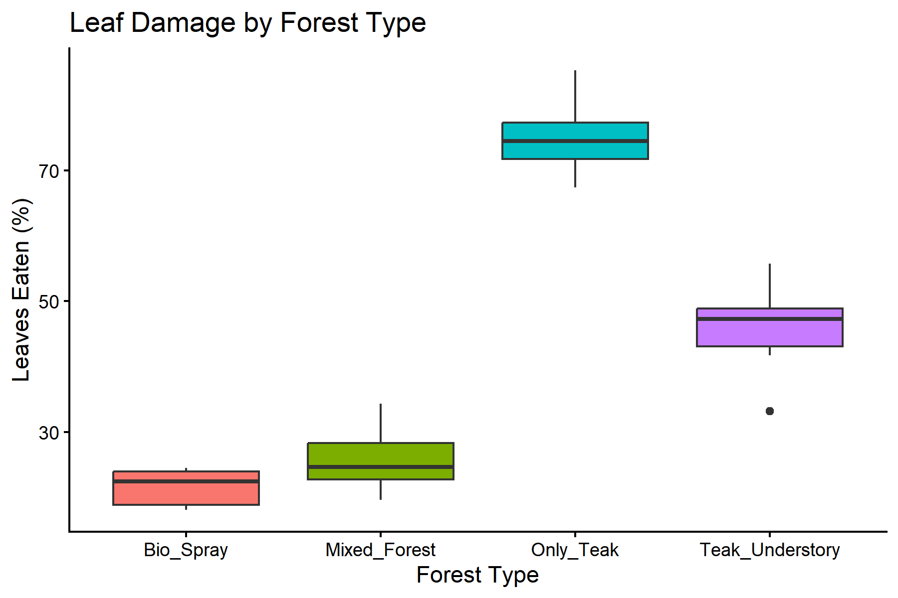

# Kerala Teak (*Tectona grandis*) – *Hyblaea puera* Defoliation & Timber Growth Analysis

This is an applied forest entomology and biostatistics project I built in **R** to quantify how silvicultural stand diversity and biological control influence **Teak Defoliator (*Hyblaea puera*)** outbreak severity and annual radial timber growth (**DBH increment**) in Kerala's Nilambur–Wayanad teak belt.

Coming from a plant and agricultural science background, I designed this analysis to practice experimental hypothesis testing (ANOVA) and growth-loss modeling (Linear Regression) in R alongside my earlier Python work on monsoon disease forecasting.

---

### Ecological Background & Problem Statement

**Teak (*Tectona grandis*)** is one of the highest-value tropical hardwoods in South India, particularly across the Nilambur Valley and Wayanad forest divisions of Kerala. At the onset of the Southwest Monsoon (May–July), plantations experience cyclical outbreaks of the **Teak Defoliator (*Hyblaea puera* Cramer, Lepidoptera: Hyblaeidae)**:

- **Canopy Loss During Peak Growth:** *H. puera* larvae feed on tender, newly flushed teak leaves right when radial cambial growth is highest. While single outbreaks rarely kill mature trees, severe defoliation strips photosynthetic capacity and significantly reduces annual wood volume increment.
- **Associational Resistance & Natural Enemies:** Even-aged monoculture plantations offer continuous host foliage and limited habitat for natural predators (parasitoid wasps, insectivorous birds) and entomopathogens. Retaining native understory vegetation, mixing teak with native moist-deciduous tree species, or applying targeted ***Hyblaea puera* Nucleopolyhedrovirus (*HpNPV*)** can suppress larval outbreaks.

---

### Research Questions

1. **Silvicultural & Biocontrol Efficacy (One-Way ANOVA):** Does canopy defoliation (`Leaves_Eaten_Pct`) differ significantly across four stand management systems (`Only_Teak`, `Teak_Understory`, `Mixed_Forest`, and `Bio_Spray`)?
2. **Timber Growth Impact (Linear Regression):** How strongly does canopy defoliation percentage reduce annual trunk diameter growth (`Trunk_Growth_cm`)?

---

### Dataset Design & Parameterization

To test these questions reproducibly without external proprietary forestry records, a **40-plot plantation dataset** (`teak_data.csv`, $n = 10$ plots per management type) was simulated in R (`set.seed(123)`) using realistic biological ranges informed by published Kerala Forest Research Institute (KFRI) teak defoliator literature:

| Stand Management Type | Ecological / Silvicultural Context | Parameterized Mean Defoliation |
| :--- | :--- | :--- |
| **`Only_Teak`** | Pure even-aged teak monoculture (high host concentration) | $\sim 75\%$ ($\text{SD} = 6\%$) |
| **`Teak_Understory`** | Teak plantation with retained native understory shrubs supporting natural enemies | $\sim 45\%$ ($\text{SD} = 6\%$) |
| **`Mixed_Forest`** | Teak intermixed with native moist-deciduous species disrupting host-finding | $\sim 28\%$ ($\text{SD} = 5\%$) |
| **`Bio_Spray`** | Targeted biological control using *HpNPV* applied at early larval instar stage | $\sim 20\%$ ($\text{SD} = 5\%$) |

Annual radial trunk growth (`Trunk_Growth_cm`) was modeled as a linear response to foliar loss starting from a healthy baseline increment of $1.30\text{ cm/year}$, decreasing at a rate of $0.01\text{ cm}$ per percentage point of canopy defoliation plus plot-level random variation ($\text{SD} = 0.06\text{ cm}$).

---

### Statistical Workflow & Key Findings

1. **One-Way Analysis of Variance (`aov`) & Tukey's HSD (`TukeyHSD`):**
   - Evaluates `Leaves_Eaten_Pct ~ Stand_Type` to test whether differences in mean foliar damage across stand types exceed within-group plot variation.
   - `TukeyHSD()` performs pairwise comparisons across all four stand types, confirming statistically significant reductions ($p < 0.001$) in defoliation under `Mixed_Forest`, `Teak_Understory`, and `Bio_Spray` compared to pure `Only_Teak` stands.
2. **Simple Linear Regression (`lm`):**
   - Models `Trunk_Growth_cm ~ Leaves_Eaten_Pct` to quantify radial growth loss per unit increase in foliar damage.
   - Confirms a strong negative linear relationship ($p < 0.001$), illustrating how severe early-monsoon defoliation directly translates into measurable annual DBH increment loss.

---

### Visualizations

#### 1. Canopy Defoliation Across Forest Stand Types

*Comparison of peak monsoon defoliation (%) across the four stand management regimes (`n = 10` plots per group). Pure teak monocultures experience the highest median defoliation, whereas mixed-species stands and HpNPV biocontrol substantially reduce canopy loss.*

#### 2. Relationship Between Canopy Defoliation and Annual Trunk Growth

*Linear regression fit (`geom_smooth(method = "lm")`) with 95% confidence interval showing annual DBH increment (`cm`) declining steadily as canopy defoliation (`%`) increases.*

---

### Repository Structure

```text
├── defoliation_boxplot.png    # Boxplot comparing leaf damage across stand types
├── README.md                  # Project background, methodology, and results
├── teak_analysis.R            # Complete R script for simulation, ANOVA, LM, and plots
├── teak_data.csv              # Generated 40-plot plantation dataset
└── trunk_growth_loss.png      # Linear regression plot of trunk growth vs. defoliation
