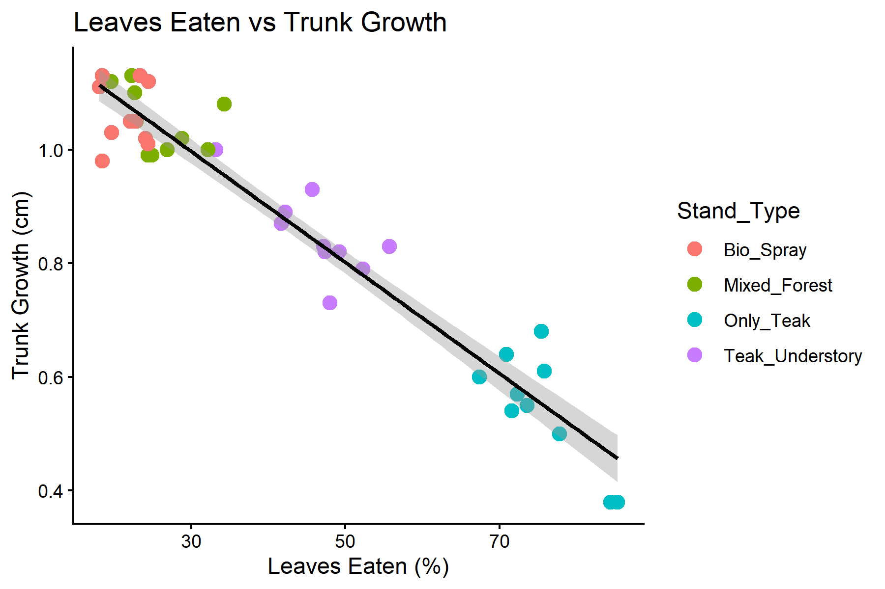

# kerala-teak-defoliation-analysis
Applied R biostatistics &amp; forest entomology analysis of Hyblaea puera defoliation and trunk growth in Kerala teak plantations.
# Kerala Teak (*Tectona grandis*) – *Hyblaea puera* Defoliation & Timber Growth Analysis

An applied forest health project built in **R** to see how smarter forest management and natural pest control can protect Kerala’s teak plantations from the **Teak Defoliator (*Hyblaea puera*)** and keep timber growth on track.

With my background in plant science, I put this project together to practice experimental analysis (**ANOVA**) and growth modeling (**Linear Regression**) in R.

---

## Why I Built This

If you have ever driven through the Nilambur Valley or Wayanad in Kerala right as the Southwest Monsoon hits (May–July), you have likely seen vast stretches of teak trees stripped nearly bare of their leaves. The culprit is the **Teak Defoliator (*Hyblaea puera*)**:
- These caterpillars feed on tender, new teak leaves right during the rainy season when the trees are putting on their fastest yearly wood growth. A single outbreak rarely kills a mature tree, but losing its canopy slows down photosynthesis and shrinks the yearly timber harvest.

- Planting huge blocks of *only* teak trees makes it easy for caterpillars to spread and leaves very little habitat for natural predators like birds and parasitic wasps. Keeping native shrubs underneath the trees, mixing teak with other native forest species, or using a targeted natural virus (***HpNPV***) can keep outbreaks under control without heavy chemical use.

---

## What I Wanted to Find Out

1. **Which forest setup protects teak leaves best?**  
   How much does leaf damage (`Leaves_Eaten_Pct`) change across four management approaches (`Only_Teak`, `Teak_Understory`, `Mixed_Forest`, and `Bio_Spray`)?
2. **How badly does leaf loss slow down tree growth?**  
   How directly does losing leaves reduce yearly trunk diameter growth (`Trunk_Growth_cm`)?

---

## About the Data

Because real long-term forestry records are often restricted, I simulated a **40-plot dataset** (`teak_data.csv`, with 10 forest plots per management style) in R (`set.seed(123)`) so anyone can run and verify the exact same results. The numbers are modeled on realistic field ranges reported by the Kerala Forest Research Institute (KFRI):

| Forest Setup | What It Looks Like in the Field | Average Leaves Eaten | Average Trunk Growth (cm/yr) |
| :--- | :--- | :---: | :---: |
| **`Only_Teak`** | Pure teak plantation with no other plant diversity | **75.5%** | **0.55 cm** |
| **`Teak_Understory`** | Teak grown with native shrubs underneath to shelter natural predators | **46.3%** | **0.85 cm** |
| **`Mixed_Forest`** | Teak mixed with other native forest trees to break up pest spread | **25.9%** | **1.05 cm** |
| **`Bio_Spray`** | Targeted biological control using *HpNPV* virus on young caterpillars | **21.6%** | **1.06 cm** |

---

## What the Data Shows

1. **Planting Mixed Forests Works Almost as Well as Bio-Spraying:**
   * How a plantation is managed makes a huge difference in caterpillar damage ($F(3, 36) = 241.19, p < 0.001$).
   * Pure teak monocultures (`Only_Teak`) took the heaviest hit, losing around **75.5%** of their leaves on average.
   * Simply leaving native shrubs on the forest floor (`Teak_Understory`) cut that damage down to **46.3%**.
   * **The most interesting takeaway:** `Mixed_Forest` (25.9% damage) and `Bio_Spray` (21.6% damage) performed almost identically—statistically, there was **no meaningful difference** between them ($p = 0.24$). In other words, designing diverse forests can protect teak naturally without needing repeated spray treatments.

2. **Losing Leaves Directly Shrinks Timber Growth:**
   * Leaf damage and trunk growth follow a tight, predictable downward trend ($R^2 = 0.93, p < 0.001$).
   * **In practical terms:** Every **10% jump in leaf damage** costs the tree roughly **0.10 cm** of yearly trunk growth. Trees in unprotected `Only_Teak` plots grew nearly half as fast (0.55 cm/yr) as trees in `Mixed_Forest` or `Bio_Spray` plots (~1.05 cm/yr).

---

## Charts

### 1. Leaf Damage Across Forest Types

*Peak monsoon leaf damage (%) across the four forest setups (10 plots per group). Pure teak stands suffer heavy defoliation, while mixed forests and bio-sprays keep the canopy healthy.*

### 2. Leaf Damage vs. Yearly Trunk Growth

*Each dot represents one forest plot. As the percentage of leaves eaten rises from left to right, yearly trunk growth drops steadily.*

---

## Limitations & What I Would Do Next

* **Simulated Data:** This dataset was generated in R to practice and showcase statistical modeling. Real field surveys across Kerala would also capture local differences in monsoon rainfall, soil fertility, and tree age.
* **Next Steps:** With multi-year field data, I would expand this into a mixed-effects model (`lme4`) to track the same plots over several monsoon seasons and compare the real-world cost of *HpNPV* spraying against mixed-species planting.

---

## Files in This Repository

```text
├── README.md                  # Project story, methods, and plain-language results
├── teak_analysis.R            # Complete R script to generate data, run tests, and create charts
├── teak_data.csv              # 40-plot dataset created by the R script
├── defoliation_boxplot.png    # Chart comparing leaf damage across forest types
└── trunk_growth_loss.png      # Chart showing how leaf damage reduces trunk growth
